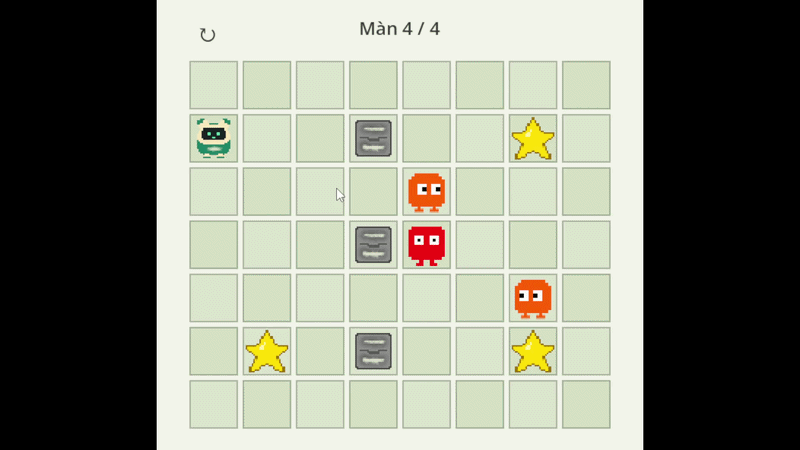

# Athena trên bàn cờ

Đây là một dự án nhỏ giúp bạn học Godot qua một trò chơi có thể chạy thử và chỉnh sửa ngay. Bạn sẽ điều khiển Athena trên một bàn ca rô để tránh kẻ địch và nhặt các sao.

Game sử dụng GDScript, gồm một màn chơi, cơ chế nhặt đồng xu, kẻ địch và điểm hồi sinh. Dự án còn có hoạt ảnh nhân vật, hiệu ứng âm thanh, nhạc nền và các hiệu ứng hình ảnh để bạn khám phá.

## Tải và chạy dự án

1. Tải toàn bộ mã nguồn dưới dạng ZIP rồi giải nén, hoặc clone kho mã nguồn.
2. Mở **Project Manager** của Godot, chọn **Import** và tìm đến file `project.godot`.
3. Mở dự án và đợi Godot nhập hình ảnh, âm thanh.
4. Nhấn **F5 / Run Project** để chơi thử.

**Phiên bản:** **Godot 4.7** với chế độ dựng hình **Compatibility**. Nên dùng phiên bản tương ứng với cấu hình dự án. Game dùng GDScript nên không cần bản .NET; hình ảnh và âm thanh đã có sẵn, không cần cài thêm plugin. Nếu chưa có, hãy tải phần mềm tại [trang tải Godot](https://godotengine.org/download/).

## Cách chơi

- **WASD / phím mũi tên**: đi một ô mỗi lần bấm.
- **Nút ↻ góc trên trái**: chơi lại màn hiện tại bất cứ lúc nào.
- Khi thua, bấm nút **Bạn đã thua! / Chơi lại** ở giữa bàn để thử lại.
- Khi hoàn thành màn, bấm nút **Màn tiếp theo**.

## Mã nguồn

Các script có chú thích tiếng Việt:

- `game.gd`: nạp màn, điều phối lượt và thắng/thua.
- `stage.gd`: kiểm tra ô bị chặn, sao và địch.
- `player.gd`, `star.gd`, `enemy.gd`: hành vi từng đối tượng.
- `grid_piece.gd`: đổi giữa tọa độ ô và vị trí pixel.

Mỗi đối tượng có scene riêng trong `scenes/entities/`, dùng ảnh qua `Sprite2D`.
Sao có `PickupSound` phát `coin.wav` khi nhặt; Athena có `DeathSound` phát `death.wav` khi chết. Cả hai là `AudioStreamPlayer`; chỉnh âm lượng bằng `Volume dB` trong Inspector.
Thứ tự một lượt: Athena đi → kiểm tra địch → nhặt sao → địch đi → kiểm tra địch → kiểm tra thắng.

## Địch đứng yên và địch đi ngang

`scripts/enemy.gd` khai báo lớp **GridEnemy**, kế thừa **GridPiece**. Script này chỉ xử lý hai trường hợp:

- **Moving** tắt: đứng yên, như `scenes/entities/enemy.tscn`.
- **Moving** bật: đi ngang, như `scenes/entities/moving_enemy.tscn`. Biến `step` bằng `1` là sang phải, `-1` là sang trái. Gặp đá hoặc mép bàn thì đổi chiều; bị chặn cả hai phía thì đứng yên.

Để tạo thêm địch ngang, nhân đôi `moving_enemy.tscn`, đổi ảnh của **Sprite2D** nếu muốn, rồi kéo scene mới vào node **Enemies** của màn. Không còn thiết lập **Direction** trong Inspector; muốn đổi kiểu di chuyển, hãy dùng lớp con như bài tập dưới.

# Tự chỉnh game theo ý bạn
## Sửa màn 1-4

Mở `scenes/stages/stage_01.tscn` (hoặc màn khác). Bật Snap **70 × 70**.
Kéo scene sao vào `Stars`, đá vào `Obstacles`, địch vào `Enemies`.
Giữ các node nhóm ở (0, 0); đặt đối tượng ở bội số của 70:
x từ 0 đến 490, y từ 0 đến 420. Giữ một Athena, ít nhất một sao và đường đi tới sao.
Không đặt đối tượng chồng nhau; đặt địch tuần tra ở các hàng khác nhau.

## Cách tạo các màn mới

1. Nhân đôi một scene trong `scenes/stages/`, đặt tên `stage_05.tscn` và sửa bố trí thêm/bớt sao, tạo kẻ địch,...
2. Mở `scenes/game.tscn`, chọn node **Game**.
3. Trong Inspector, mở **Stages**, thêm một phần tử rồi kéo `stage_05.tscn` vào cuối danh sách.
4. Lưu scene và bấm F5. Hoàn thành màn 4 sẽ đi tiếp tới màn 5.

## Thực hành: tạo địch mới có thể di chuyển dọc

### Cho địch một asset

1. Mở `scenes/entities/vertical_enemy.tscn`. Scene đã gắn script ngoài `scripts/vertical_enemy.gd`; hãy chỉnh file này thay vì tạo script bên trong scene.
2. Chọn **Sprite2D**, kéo `assets/sprites/vertical_enemy_pixel.png` vào **Texture**. Ảnh tím được chuẩn bị sẵn; scene chưa gán ảnh để bạn tự thực hành.
3. Giữ **Scale = (2, 2)** và lọc **Nearest**. Ảnh dùng **Process > Size Limit = 32** trong tab Import.
4. Chọn node gốc **VerticalEnemy**, bật **Moving**. Kéo scene vào **Enemies** của một màn thử và đặt ở ô trống, Snap **70 × 70**.

### Kế thừa (OOP) và ghi đè hàm

`vertical_enemy.gd` bắt đầu bằng `extends GridEnemy`. Điều này cho lớp con dùng lại biến `moving`, `step` và các hàm `get_cell()`, `move_to()` được kế thừa qua `GridPiece`.

Lớp con định nghĩa lại **`take_turn(stage)`** để thay thế cách đi ngang của lớp cha. `stage.gd` vẫn gọi cùng tên hàm cho mọi địch, nhưng Godot sẽ chạy phiên bản của lớp con nếu có. Không cần sửa bộ điều khiển game hoặc thêm signal.

Không gọi `super.take_turn(stage)` trong bài này: hàm cha sẽ thực hiện thêm một bước ngang. Cũng không cần `_process()` hay `_physics_process()` vì địch chỉ đi khi được màn chơi gọi đến lượt. Có thể kế thừa `_ready()` của lớp cha mà không viết lại.

### Tự hoàn thành ba TODO trong `vertical_enemy.gd`

Khung script hiện tại đang **thiếu đoạn code** để khiến kẻ địch có thể chạy. 

1. **Tính ô đích:** di chuyển dọc thì thành phần nào của tọa độ thay đổi? Giữ nguyên cột x và dùng `step` cho hàng y. Trong lớp con, `1` là xuống và `-1` là lên.
2. **Quay đầu:** nếu `stage.is_blocked(target)` đúng (Có chứng ngoại vật), đổi chiều và tính lại ô đích. Tham khảo nhánh tương ứng của `enemy.gd`.
3. **Di chuyển:** sau khi kiểm tra lại ô đích không bị chặn, gọi hàm chuyển ô đã có trong `GridPiece`. Thay `pass` ở nhánh này bằng phần xử lý của bạn.

Không cần lật ngược cả sprite khi đi lên; hàm lật ảnh ngang của lớp cha không phải yêu cầu của bài tập này.

### Tự kiểm tra

- Địch đi đúng một ô dọc sau mỗi bước hợp lệ của Athena; Athena bấm vào đá thì địch không đi.
- Địch quay đầu ở mép trên, mép dưới và đá; nếu cả hai phía bị chặn thì đứng yên.
- Chạm địch trước hoặc sau lượt đều làm Athena thua.
- Địch đỏ vẫn đứng yên và địch cam vẫn đi ngang; chỉ sửa lớp con để hoàn thành bài tập.

Không đặt địch chồng lên sao, đá hay Athena. Bố trí đường tuần tra không giao nhau vì các địch không chặn lẫn nhau.
